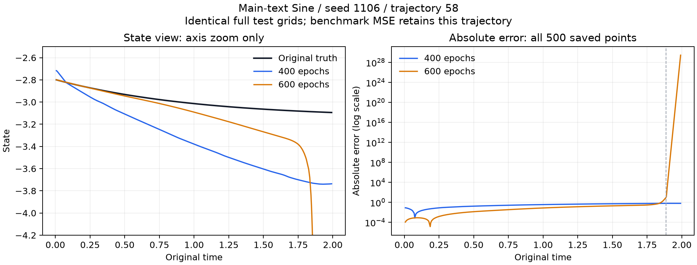

155/285 deduplicated complete original CFM models

Current native/independent proof chains and artifact hashes were rechecked. Overlapping snapshots are deduplicated by canonical identity, never summed. The previous152 records remain identical. All newly closed original source grids and metrics were independently recomputed.

| New canonical model | Epochs | Updates | Original grid | MSE | MAE | RMSE | Bitwise native scores |
| --- | ---: | ---: | --- | ---: | ---: | ---: | --- |
| cfm_ts_original__main_text__gp_gaussian_conditional_e600__sine__seed1104 | 600 | 93600 | [20, 500, 1] | 0.00107519589506 | 0.0206318474265 | 0.0327901798571 | True |
| cfm_ts_original__main_text__gp_gaussian_conditional_e600__sine__seed1105 | 600 | 93600 | [20, 500, 1] | 0.00117822402586 | 0.0256916893716 | 0.0343252680376 | True |
| cfm_ts_original__main_text__gp_gaussian_conditional_e600__sine__seed1106 | 600 | 93600 | [20, 500, 1] | 8.65403332009e+54 | 3.78019645187e+25 | 2.94177383904e+27 | True |

Appendix conditional GP600/Sine now has four complete finite seeds1103,1105,1106,1107 and the independently observed full80-grid failed seed1104. Full five-seed600 MSE remains undefined. The separate all-five original400/600 attempt-outcome audit retains that failure. Main20-test/93600-update GP600 recipes remain distinct from Appendix80-test/375000-update recipes; no combined performance mean, seed exclusion, altered solver or successful-subset benchmark. Original-author equivalence and strict TAB remain unproved; all285 slots and45/681/273scope remain required.

Paper: https://openreview.net/forum?id=Hqn4Aj7xrQ

Main GP600 seed1106 retains its full original MSE8.654033320088157e54, despite all20x500 predictions being finite and bitwise reproducible. Trajectory58 has MSE1.7308066640176315e56 and accounts for approximately100% of total squared error at floating-point precision; the other19 trajectories remain in the benchmark. Median trajectory MSE is0.004681507356985399. Initial state-2.7972049725526644 lies within observed training-state range[-2.9921020979750437,3.0093896256309485]. The first saved prediction with magnitude above10 is at t1.8874931267797401, inside observed training-time range[2.1019140948430604e-05, 1.999420813812872]. Maximum absolute prediction is2.8536148066437902e29 versus maximum absolute truth3.094120637107615.

The same full20-trajectory data/IDs/times/truth and first400 loss prefix were verified against the previously restored original GP400 seed1106 checkpoint. Its full MSE is0.010382748616646342; trajectory58 MSE is0.16914204152399054 and maximum absolute prediction3.740164279937744. No intermediate600-run weights or optimizer equality, continuous RHS trace, exact divergence time, isolated training-RNG cause, or author-code bug is certified.

The left panel zooms the state axis for readability; the right panel includes all500 original saved error coordinates on a logarithmic axis. This is a plot of saved arrays, without new model inference, removed trajectories, clipping benchmark values or solver changes. The complete five-seed Main400/600 comparison still requires the remaining600 models.
