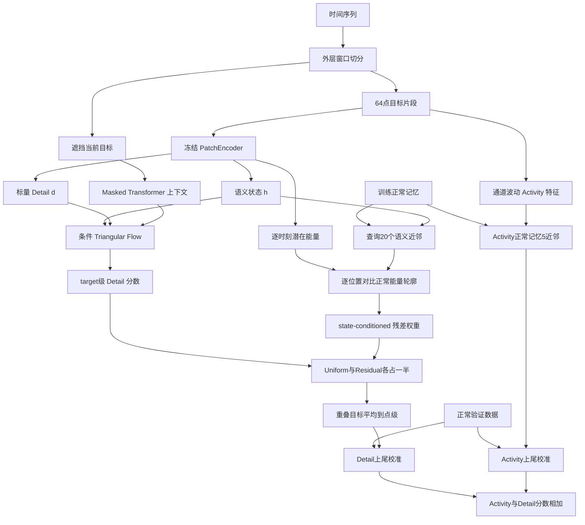

# MTDA + State-Conditioned Energy Residual：方法详解

## 1. 方法由哪些部分组成

按处理顺序，这条方法包含：

1. 将时间序列按数据集既定的外层窗口切分，再在窗口中抽取长度为 64 的 target。
2. 用冻结的 PatchEncoder 把 target 编码为 64 维语义状态和 1 维局部 Detail 坐标。
3. 隐去 target 的原始值，用同一外层窗口的其余观测产生上下文。
4. 将 65 维 target 和上下文输入条件 Triangular Flow，计算 target 级 Detail 密度分数。
5. 从编码器的未池化特征图计算逐时刻 latent-energy 曲线，并依据语义相似的正常 target 建立局部能量参考。
6. 计算 state-conditioned residual，将 target 级 Detail 分数按 50% Uniform + 50% Residual 分配到 64 个位置。
7. 对重叠 target 的分数取点级平均，在正常验证数据上校准 Detail 和 Activity，再相加得到最终点级分数。

不判断一个运行状态是否罕见，而是判断当前状态和上下文下的行为是否符合正常规律；在此基础上，将窗口级异常证据归因到与该状态正常时间模式不一致的区域，并以活动正常性补充整体运行模式的异常信息。

## 2. 数据窗口和 target 网格

设多变量时间序列为 $X\in\mathbb{R}^{T\times C}$，其中 $T$ 是时间长度，$C$ 是通道数。每个数据集使用既定的外层窗口长度 $L$。当前七个数据集的外层窗口长度为：

| 数据集 | 外层窗口长度 $L$ |
|---|---:|
| GECCO | 128 |
| MSL | 96 |
| PSM | 192 |
| SMAP | 192 |
| SMD | 192 |
| SWAN | 192 |
| SWAT | 192 |

对一个外层窗口 $W_b\in\mathbb{R}^{L\times C}$，target 长度固定为 $P=64$。训练时在合法偏移 $o\in[0,L-P]$ 中抽取 target；推理时用步长 16 的偏移网格，并始终加入最后一个合法偏移：

$$
\mathcal{O}_L
=
\{0,16,32,\ldots\}
\cup
\{L-64\}.
$$

例如 $L=128$ 时，target 偏移为 $0,16,32,48,64$。相邻 target 有重叠；最终会把覆盖同一时间点的 target 分数取平均。

外层窗口之间不传递上下文。一个 target 的上下文只来自它所在的外层窗口。

## 3. PatchEncoder：从原始 target 得到表示

### 3.1 卷积特征图和语义状态

每个 64 点 target 按通道优先排列后送入一维卷积编码器。编码器包含四个卷积块，通道数为 128、256、128、64，卷积核大小依次为 7、5、3、3；每个卷积块包括卷积、Batch Normalization 和 ReLU。卷积步长为 1，使用保长度的填充。当前实现的该编码器不启用 RevIN。

卷积输出记为 $H_i\in\mathbb{R}^{64\times64}$。第一个维度为隐特征通道，第二个维度对应 target 内的时间位置。对时间维做自适应平均池化，得到 64 维语义状态：

$$
h_i
=
\operatorname{Pool}_{t}(H_i)
\in\mathbb{R}^{64}.
$$

$h_i$ 描述 target 的整体潜在状态。state-conditioned residual 会用它检索状态相似的正常样本。

### 3.2 预训练与冻结

PatchEncoder 在正常数据上预热，随后在 masked-context Flow 阶段保持冻结。预热阶段使用两类信号：

- 先取一个正常 patch 当锚点，再从它附近取一个 patch 当正样本。因为它们时间上接近，通常状态也比较相似，所以希望编码器把它们映射得更近。再从别的位置拿一个不相关 patch 当负样本，希望编码器把它推远。

- 构造“相邻前序片段”与“随机片段”的二分类任务；让模型做一个判断题：这两个片段到底是不是时间上真正相邻的？

  正样本用真实相邻片段，负样本用随机片段。

  这样可以逼着 Encoder 学到：正常时间序列里的前后关系和局部动态，而不是只记住数值大小。

最后训练得到一个正常状态表示器，它负责把每个正常 patch 变成一个有意义的语义向量 \(h\)。然后 Encoder 冻结。

PaAno 学完 patch 表征后，直接用测试 patch 的 embedding 与正常 memory bank 的近邻距离来判断异常，也就是“离正常表示越远越异常”；我用类似的 patch 表征预训练，但 \(h\) 不直接作为异常分数，而是作为flow条件，同时再用 \(h\) 去找同状态正常样本做时间归因。

### 3.3 Flow 使用的标量 Detail 坐标

除了池化得到 $h_i$，模型还从同一份未池化特征图计算一个标量 Detail 坐标。先在每个隐特征通道内减去 target 内时间均值，再计算整体平方变化并取对数：

$$
d_{i,\mathrm{raw}}
=
\log\left(
1+
\frac{1}{64\cdot64}
\sum_{c=1}^{64}\sum_{t=1}^{64}
\left(H_i(c,t)-\bar H_i(c)\right)^2
\right),
$$

其中：

$$
\bar H_i(c)
=
\frac{1}{64}\sum_{t=1}^{64}H_i(c,t).
$$

假设某个隐特征在 64 个时间点是：

2.0,2.1,1.9,2.0 它基本不动，那么平方偏差很小。

0.5,3.0,1.0,4.0上下变化很厉害，那么平方偏差就大。

在问：第 \(c\) 个隐藏特征，在第 \(t\) 个位置偏离自己正常水平多少？

然后把 64 个隐藏特征 × 64 个时间位置全部平均：表示整个64点 target 在 latent space 里的总体内部变化强度

再做log(1+)只是为了把特别大的数值压缩一下，避免少量极大波动支配整个尺度。

用所有正常训练 target 计算中位数 $m_d$ 和 MAD 标准化：
$$
d_i
=
\frac{d_{i,\mathrm{raw}}-m_d}
{\max(1.4826\,\operatorname{MAD}_{\mathrm{train}}(d_{\mathrm{raw}}),10^{-4})}.
$$

把它变成这个 target 的 Detail 相比正常水平偏了多少。

越接近0说明 Detail 很接近正常训练数据的典型水平。越大表示它越高于正常 Detail 水平。

1.4826 是 MAD 在正态分布假设下的标准换算系数。

于是 Flow 的完整 target 表示为：
$$
y_i=[h_i,d_i]\in\mathbb{R}^{65}.
$$

64维h表示这是什么状态，1维d表示这个状态内部变化有多强

后面的 $E_i[0:64]$ 是逐时刻能量曲线，负责后处理定位。前面计算 \(d\) 的过程中，可以先保留每个时间点自己的能量：
$$
\sum_{t=1}^{64}
\left(H_i(c,t)-\bar H_i(c)\right)^2
$$

假设：E=[1,1,1,1,1,10,12,9,1,1 \]

那么 \(d\) 只告诉 Flow这个窗口总体 Detail 比较强。

但它已经不知道是第 6～8 个位置导致的。

所以把 $E_i[0:64]$ 留下来，后面 state-conditioned residual 再利用它做时间归因。

## 4. Masked Transformer：建立不泄漏 target 原始值的上下文

对当前外层窗口中的 target，先构造二值有效位置向量 $m_t$：target 内位置标记为 0，其余位置标记为 1。原始窗口值乘以该有效标记，并与有效标记本身拼接：

$$
\tilde x_t=[m_t x_t,\ m_t].
$$

有效标记让模型能区分“原本观测值就是零”和“被遮挡后置零”。经线性层映射到 128 维后，再加位置编码，让模型知道每个位置在窗口里的前后顺序。

上下文编码器放进去 5 个可学习 query，它们去看 target 周围的上下文，各自总结一部分信息，比如整体趋势、前后变化、不同局部模式等。它们没有人工规定各自负责什么，而是训练过程中自己学。

使用两层、4 个注意力头的 Transformer。Transformer 对 target 位置设置 key/value padding mask：这些位置不会被上下文 query 读取。5 个 query 的输出经 LayerNorm 和线性层压到每个 64 维；再把当前窗口可用位置比例附加为第 65 个分量：
$$
c_i^{(1)},\ldots,c_i^{(5)}\in\mathbb{R}^{65},
\qquad
c_i=
\operatorname{Flatten}
\left(c_i^{(1)},\ldots,c_i^{(5)}\right)
\in\mathbb{R}^{325}.
$$

target 前后未遮挡的位置都可能贡献上下文，所以该编码器在外层窗口内是双向的；它不读取 target 的原始值，也不跨外层窗口读取，是离线检测。

## 5. Triangular Conditional Flow：拟合条件正常分布

### 5.1 三角分解

条件 Flow 接收 65 维 target $y_i=[h_i,d_i]$ 和 325 维上下文 $c_i$。其向量场分成语义块和 Detail 块：

$$
v_h=v_h(h,c),
\qquad
v_d=v_d(d,h,c).
$$

语义块应该怎样随着 Flow 变化，只由状态本身和上下文 \(c\) 决定。

Detail 块根据当前 Detail、语义状态和上下文变化。

Detail 不回馈到语义块，Detail 块可以依赖语义块，语义块不依赖Detail 块

这种结构使联合密度可以按语义部分与条件 Detail 部分分解：
$$
p(h,d\mid c)=p(h\mid c)\,p(d\mid h,c).
$$

也就是一个样本出现的概率，可以分成两部分：
① 当前这种状态 \(h\) 在上下文 \(c\) 下常不常见；
② 已经知道当前是这种状态以后，出现这样的 Detail \(d\) 合不合理。

检测重点不是第①项，因为第①项小有可能只是说明这个运行状态比较少见，少见不一定异常。

本模型的主要检测分支使用 Detail 贡献，就是只问既然当前已经是这个状态 \(h)，而且上下文是 \(c)，那现在这个 Detail \(d\) 正常吗，因此 target 级 Detail 分数可解释为：
$$
s_i^D
=
-\log p(d_i\mid h_i,c_i)
\quad\text{的 Flow 估计值。}
$$

分数越大，表示在当前语义状态和窗口上下文下，局部 Detail 越不符合训练正常分布。

### 5.2 Flow Matching 训练

设真实正常 target 为 $y_i$，从标准高斯分布采样噪声 $z_0\sim\mathcal N(0,I_{65})$，并采样 $\tau\sim U(0,1)$。线性插值得到中间状态和目标速度：

$$
z_\tau=(1-\tau)z_0+\tau y_i,
\qquad
u_\tau=y_i-z_0.
$$

条件速度网络输入 $(z_\tau,\tau,c_i)$，训练目标是预测 $u_\tau$：

$$
\mathcal L_{\mathrm{FM}}
=
\mathbb E_{y_i,z_0,\tau}
\left[
\left\|
v_\theta(z_\tau,\tau,c_i)-u_\tau
\right\|_2^2
\right].
$$

masked-context 编码器和 Flow 速度网络用这个目标共同更新；PatchEncoder 已被冻结。每个训练 target 都来自 fit-train 正常分割。验证损失用于 checkpoint 选择和早停。

该 Flow 的基线结构使用 128 维隐藏层、4 个注意力头和 2 层速度网络。

### 5.3 从速度场计算 Flow 密度分数

训练目标是 Flow Matching 速度误差；推理时用学到的连续流对 target 进行密度估计。模型将状态从数据端沿速度场积分至高斯端，并累积散度项，形成变量变换的 log-determinant 修正。积分采用 Runge–Kutta 四阶方法，当前配置为 4 个 ODE 步；散度通过 Hutchinson 随机迹估计。

异常分数：

$$
s_i^{D}
=
s_{i,\mathrm{Gaussian}}^{D}
+
s_{i,\mathrm{divergence}}^{D}.
$$

这里的 $s_i^D$ 是一个 target 级标量。它评估整个 64 点 patch 的 Detail 是否异常，本身并没有指出 patch 内具体哪个时刻贡献最大。

这个 Detail 倒回高斯以后落点罕不罕见 + 为了把它送回去，Flow 经历了多大的空间形变。

## 6. 用状态条件能量残差定位 target 内时间点

### 6.1 逐时刻 latent energy

从编码器的特征图 $H_i$ 计算 64 个逐时刻能量。每个隐特征通道先减去该 target 内的时间均值，然后在通道维求平均：

$$
E_i(t)
=
\frac{1}{64}
\sum_{c=1}^{64}
\left(H_i(c,t)-\bar H_i(c)\right)^2,
\qquad t=1,\ldots,64.
$$

为压缩动态范围，转到对数空间：

$$
z_i(t)=\log(E_i(t)+10^{-6}).
$$

这条曲线描述编码器在 target 内各位置的局部变化强弱。

### 6.2 用语义近邻建立局部正常轮廓

将语义向量做 L2 归一化：

$$
\hat h_i=\frac{h_i}{\|h_i\|_2}.
$$

在 fit-train 正常记忆中，按余弦相似度找与 $\hat h_i$ 最接近的 $k=20$ 个 target：

$$
\mathcal N_{20}(i)
=
\operatorname{TopK}_{j\in\mathrm{train}}
\left(
\hat h_i^\top\hat h_j,\ 20
\right).
$$

每个正常记忆条目保存一对特征：语义状态 $h_j$ 与对应能量曲线 $E_j[1:64]$。对近邻的每个相对位置 $t$，计算对数能量的中位数：

$$
\mu_i(t)
=
\operatorname{median}_{j\in\mathcal N_{20}(i)}
z_j(t).
$$

邻居局部尺度为：

$$
\sigma_i^{\mathrm{local}}(t)
=
1.4826\,
\operatorname{median}_{j\in\mathcal N_{20}(i)}
|z_j(t)-\mu_i(t)|.
$$

此外，用 fit-train 全局数据估计每个相对位置的尺度下限：

$$
\sigma^{\mathrm{floor}}(t)
=
\max\left(
10^{-3},
0.05\times1.4826\,
\operatorname{MAD}_{j\in\mathrm{train}}(z_j(t))
\right).
$$

最终使用的稳健尺度是：

$$
\sigma_i(t)
=
\max\left(
\sigma_i^{\mathrm{local}}(t),
\sigma^{\mathrm{floor}}(t)
\right).
$$

中位数和 MAD 可降低少数异常记忆条目对正常参考的影响；尺度下限避免局部 MAD 接近零导致残差爆大。

### 6.3 逐位置残差和归一化权重

当前 target 相对于相似状态正常参考的残差为：

$$
r_i(t)
=
\min\left(
\frac{|z_i(t)-\mu_i(t)|}{\sigma_i(t)},
20
\right).
$$

绝对差值表示能量显著偏高或偏低都可能异常；除以稳健尺度后，不同位置可以按各自正常波动范围比较；上限 20 是预先固定的残差截断。

再把 64 个残差转换成总和为 1 的权重：

$$
w_i^R(t)
=
\frac{r_i(t)+10^{-6}}
{\sum_{u=1}^{64}(r_i(u)+10^{-6})},
\qquad
\sum_{t=1}^{64}w_i^R(t)=1.
$$

加上 $10^{-6}$ 是为了让所有位置都保持非零权重，也避免残差总和为零时无法归一化。

## 7. 50% Uniform + 50% Residual 分数分配

对于 target 级 Detail 分数 $s_i^D$，均匀定位对应每个相对位置的分数都是 $s_i^D$。Residual-only 的分数为 $64s_i^D w_i^R(t)$。选定基线将二者各取一半：

$$
D_i^{U+R}(t)
=
0.5\,s_i^D
+
0.5\left(64s_i^D w_i^R(t)\right).
$$

等价地：

$$
D_i^{U+R}(t)
=
s_i^D\left(0.5+32w_i^R(t)\right).
$$

它也可写成权重混合形式。定义：

$$
w_i^{U+R}(t)
=
\frac{0.5}{64}
+
0.5w_i^R(t),
$$

则：

$$
D_i^{U+R}(t)
=
64s_i^D w_i^{U+R}(t).
$$

这里的 50/50 明确指 **target 内 Detail 分数的两个定位规则**。Flow 决定这个窗口“总体有多异常”，Residual 决定异常证据“更应该放在哪些时间点”；最终一半保留窗口级统一证据，一半用状态条件 residual 做时间上的重新分配。

## 8. 从 target 局部分数生成点级 Detail 流

1-100

20  4  192  64 16

每个 target 的相对时间位置 $t$ 映射回原序列位置 $q=b+o+t$，其中 $b$ 是外层窗口起点，$o$ 是 target 在窗口内的偏移。

同一个绝对时间点 $q$ 通常被多个重叠 target 覆盖。设覆盖它的 target 集合为 $\mathcal I(q)$，点级原始 Detail 分数为：

$$
a_D(q)
=
\frac{1}{|\mathcal I(q)|}
\sum_{i\in\mathcal I(q)}
D_i^{U+R}(q-b_i-o_i).
$$

验证流和测试流使用相同的 target 网格和重叠平均方式。Activity 点级流也用其 target 分数按相同区间映射和重叠平均规则生成。

## 9. 正常验证校准与 Activity 融合

### 9.1 有限样本上尾校准

把正常验证点级 Detail 分数记为排序后的参考集合 $R_D=\{a_D^{\mathrm{val}}(q)\}$，数量为 $n_D$。对测试点 $q$，计算：

$$
\hat p_D(q)
=
\frac{
1+\#\{v\in R_D:v\ge a_D^{\mathrm{test}}(q)\}
}{
n_D+1
},
$$

$$
q_D(q)=-\log\hat p_D(q).
$$

若一个测试点的原始 Detail 分数超过绝大多数正常验证分数，则 $\hat p_D$ 较小、$q_D$ 较大。当前 Detail 定位变体使用它对应的正常验证点级分数做校准。

先拿一批正常验证点，看看“正常情况下 Detail 分数通常有多大”；测试点来了以后，看它的分数能排到正常分数的多靠前位置。越超过正常样本，越异常。

假设正常验证集只有 9 个点，它们的 Detail 分数是：

1,2,2.5,3,4,5,6,7,8

现在一个测试点的原始 Detail 分数是：

6.5

正常验证分数里，至少和 6.5 一样大的只有：

\[ 7,8 \]

一共 2 个。

所以：

p= (1+2)/(9+1) = 0.3

这个 \(0.3\) 可以理解成在正常数据里，出现“至少这么大的 Detail 分数”的概率大约是 30%。

再做： q=-log(0.3)=1.2

所以异常证据不算特别大。

再看一个更异常的点。假设：

10

正常验证集里没有任何一个分数达到 10，因此：

p= (1+0)/(9+1) = 0.1

于是：

 q=-log(0.1)=2.3

显然比前面的 1.20 大。

所以规律就是：

测试分数越大，正常验证里超过它的点越少，p 越小，q 越大

### 9.2 Activity 分支

Detail 分支看“当前状态下细节行为合不合理”，Activity 分支则专门看“这一整个 64 点窗口里，各个变量活跃得正不正常”。

Activity 分支针对每个 target 的通道波动构造特征。对每个通道 $c$ 计算 64 点标准差：
$$
s_{i,c}^{\mathrm{act}}
=
\operatorname{Std}_{t=1:64}X_i(t,c).
$$

然后对 $\log(s_{i,c}^{\mathrm{act}}+\epsilon)$ （主要是为了压缩范围，因为标准差可能有的只有 \(0.01\)，有的却是 \(100\)，差距太大)。使用正常经验分布做 Gaussian-rank 转换，并拼接每个通道是否处于有效活动状态的指示量。对转换后的 Activity 特征，在训练正常 Activity 记忆中找 5 个欧氏近邻，以平均距离作为 target 级 Activity 分数。target 到点的映射、重叠平均和正常验证上尾校准与 Detail 分支分别进行，最终得到 $q_A(q)$。

假设一个 target 有 3 个通道，64 点标准差算出来是：

0.2、3.0、 0.8

问题是，不同通道本身量纲和正常波动范围不同。比如 CPU 的标准差 0.8 可能已经很大，但网络流量的标准差 3.0 可能很普通，所以不能直接比较这些原始数值。

于是先看每个数在**该通道正常训练数据中的排名**。例如某通道当前标准差比 90% 的正常样本都大，那么经验分位大约是：

\[ 0.9. \]

Gaussian-rank 再把这个分位映射到标准正态坐标：

 0.5->0              0.9-> 1.2        0.99->2.33

所以它相当于把：

> “标准差具体是多少”

转换成：

> “相对于这个通道自己的正常历史，它现在有多高或多低”。

这样不同通道就进入了一个统一尺度。

然后再给每个通道加一个 **0/1 活动标记**。例如：1,0,1

表示第 1、3 个通道当前处于有效活动状态，第 2 个基本不活跃。于是 Activity 特征里同时包含：

每个通道活动强度在正常中的相对位置和这个通道当前到底活不活跃两类信息。

[强度位置1, 强度位置2, 强度位置3 | 1, 0, 1]

当前 target 的整组特征会与正常训练 Activity memory 中的特征计算欧氏距离，选出最近的 5 个，再取距离平均值。假设最近 5 个正常样本的欧氏距离是：

\[ 0.3,\ 0.4,\ 0.6,\ 0.5,\ 0.4 \]

那么：

0.3+0.4+0.6+0.5+0.4/5=0.44

距离很小说明：当前哪些通道在动、动得多厉害，这种组合和正常样本很像。

如果最近 5 个距离是：

\[ 3.0,\ 3.5,\ 4.2,\ 3.8,\ 4.0, \]

平均距离很大，就说明前整个 Activity 模式在正常训练数据里很少见。

### 9.3 最终点级异常分数

最终输出是校准后的 Activity 和 Detail 证据之和：

$$
S(q)=q_A(q)+q_D(q).
$$

## 10. 端到端推理步骤

对每个外层窗口，推理按以下顺序运行：

1. 根据 stride-16 网格和最终有效偏移列出所有 64 点 target。
2. 对每个 target，用冻结 PatchEncoder 计算语义 $h_i$、标准化 Detail $d_i$ 和未池化特征图 $H_i$。
3. 将 target 原始值从当前外层窗口上下文中屏蔽，计算 325 维上下文 $c_i$。
4. 把 $[h_i,d_i]$ 和 $c_i$ 输入冻结 Triangular Flow，得到 target 级 Detail 分数 $s_i^D$。

1. 从 $H_i$ 计算 64 点能量轮廓 $E_i(t)$。
2. 用 $h_i$ 查询 fit-train 正常语义记忆的 20 个近邻，计算局部能量中位数、MAD 尺度和残差 $r_i(t)$。
3. 把 $r_i(t)$ 归一化为 $w_i^R(t)$，按 50% U + 50% R 公式得到 $D_i^{U+R}(t)$。
4. 将所有重叠 target 的局部分数平均到原序列点，得到原始 Detail 点级流。

1. 用正常验证点级流分别校准 Detail 和 Activity。

1. 输出 $S(q)=q_A(q)+q_D(q)$。

正常数据用于特征训练、Detail 尺度拟合和正常记忆；验证正常数据用于 checkpoint 选择和分数校准

## 创新点

1、区分“状态少见”和“真正异常”。

2、根据当前状态定位更可疑的时间区域。

3、联合建模局部细节异常和整体活动异常。

我们目前work的一个点在于：把patch提取一个特征d，加上原来patch内所有时间点的特征和上下文，相当于对于局部和整体进行了联合建模。效果是提取了整体特征d的效果比

## 补写（2026-10-16）：把上一句写完

上一句在“效果比”处截断。这里按已有的七模型表把比较对象写全。没有内部消融的句子标明为假设，不写成已经测到的提升。

提取整体特征 \(d\)，再让它条件于语义状态 \(h\) 和掩码上下文 \(c\)，效果比下面两类已有做法更好，也比一类局部做法更差。

比“只用状态嵌入到正常记忆的距离”更好。PaAno 的分数就是这种距离。少见但正常的工况会离记忆中心很远，从而被打成异常。\(d\mid h,c\) 不再问这个状态少不少，只问这个状态下的整体细节强不强得过分。SWAT 上 PaAno 的 AUC-ROC 是 0.342，MTDA 是 0.871。PSM 上是 0.538 对 0.753。这是表里能支持的主要收益。

比“在更高维表示上直接做流”更好。MTGFlow 和 LatentFlow 的宏平均 AUC-ROC 是 0.678 和 0.635，MTDA 是 0.788。\(d\) 把要估计的密度收成一维条件分布，避开了高维似然不稳。这不说明三角流或 ODE 步数是贡献，只说明检测对象变窄之后更好估。

比“只保留逐时刻能量、不先做成整体 \(d\)”是否更好，笔记里没有这一行消融，不能写成已证实。现有实现是先把 64 个位置收成一个 \(d\)，Flow 只给这个标量打分，再按 50% 均匀加 50% 能量残差摊回去。整体 \(d\) 提供的是段级证据：形状还像、但整段起伏偏高时，纯逐点形状距离会漏。逐点能量提供的是位置。两者是“先汇总、再摊回”，不是一个联合分布。

比“有 \(d\) 和 \(h\)、但没有掩码上下文 \(c\)”应当更好，同样没有内部消融。\(c\) 的作用是不让模型用 target 自己的原始值解释自己。这一句留作假设。

比针对单点偏离的局部距离更差。SMAP 上 MTDA 的 AUC-ROC 是 0.577，PaAno 是 0.670，MTGFlow 是 0.593。GECCO 上 CrossAD 的 AUC-PR 是 0.551，MTDA 是 0.457。一个采样点上的尖峰会被 64 点的整体 \(d\) 稀释。

因此上一句不能写成“局部和整体已经联合建模，所以效果更好”。能写进论文的版本是：在这七个数据集的外部对照里，状态和上下文条件化之后的整体细节强度，优于状态嵌入距离，也优于更高维上的流；它不优于单点局部距离。Activity 是另一路校准后相加，逐时刻能量是事后摊分。有 \(d\) 对无 \(d\)、有 \(c\) 对无 \(c\)、有残差对无残差，这三组内部对比还没有测，不能写成模块贡献。
